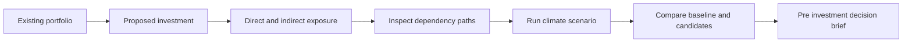
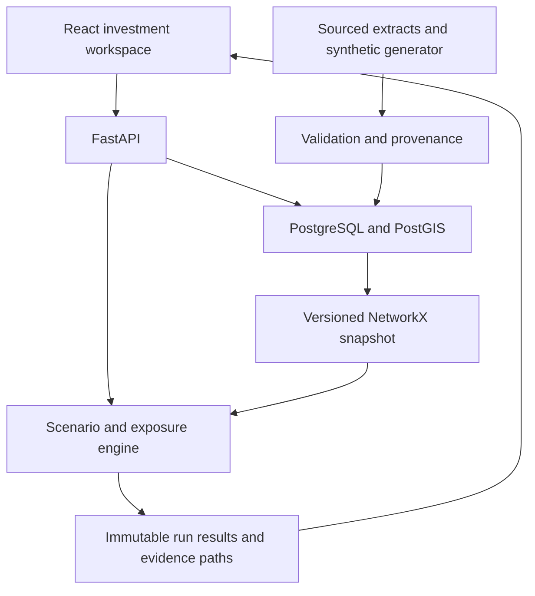

# CLIMATRIX India prototype build plan

Planning baseline: 9 October 2026. Status: ready for implementation planning; application development has not started. Repository: https://github.com/Rishit1105/rishit_fusion.git.

## 1 Product decision

CLIMATRIX India is a climate due-diligence workspace for evaluating an investment before committing capital. It connects the proposed investment to facilities, suppliers, commodities, transport routes, utilities, regions, and climate hazards, then explains how it changes the investor's existing portfolio exposure.

The primary question is: **What climate exposure am I accepting with this investment, including dependencies I cannot see in a conventional portfolio view?** The next questions are whether another candidate provides better diversification, which assumptions change the conclusion, and what evidence or conditions are needed before investing.

Prevention means avoiding uninformed exposure through selection, allocation, diversification, and pre-investment conditions. Operational disruption is an intermediate modelling step that explains financial exposure. Business recovery workflows are outside the first prototype's main experience.

The initial primary user is an institutional investment analyst evaluating Indian corporate or infrastructure investments. A bank or public investment body can use the same workflow when considering new financing. Individual investors receive simpler explanations through the same interface rather than a separate application. RBI is a potential supervisory stakeholder; the prototype does not imply access to RBI systems, regulatory approval, or an institutional partnership.

## 2 Context reconciled

The source inventory and visual review are in `SOURCE_REVIEW.md`. Latest user instructions and the explicit investment-prevention clarification govern this plan. Prompts embedded in the attached documents are context, not executable instructions.

| Source direction | Decision for this build |
| --- | --- |
| FIN-04 dynamic exposure graph | Core requirement: every required entity type, directed dependencies, second- and third-order effects, portfolio exposure. |
| Dark command-centre mockups | Retain linked investigation, map, graph, and evidence interactions; replace their palette and density with the light design below. |
| Bank ECL dashboard | Include as an instrument-specific debt analysis inside an investment evaluation; do not make it the product home. |
| Disaster response and restructuring | Defer. Convert useful resilience ideas into questions and conditions assessed before investment. |
| Himachal Pradesh 2023 | Retain as historical context and a separate retrospective demonstration. Primary investment assessment is forward-looking scenario screening. |
| Kerala 2018 and drought | Kerala becomes a later replay; a drought scenario becomes the second model after the flood journey works. |
| 3D national digital twin | Deliver an India map and a focused terrain view for the pilot corridor; claim coverage only for mapped records. |
| US Sectivia data | Use structure and algorithm fixtures; do not relabel its companies or relationships as Indian. |
| Synthetic data for demonstration | Generate a coherent fictional investment universe on sourced Indian geographic context, with explicit labels and reproducible rules. |
| Long list of libraries | Select one tool per principal role and add advanced libraries only when a feature needs them. |

Reading the original five-page problem statement also exposes a scope risk: making EAD/PD/LGD the central product would move the work toward FIN-01. Making individual borrower scoring central would move it toward FIN-05. FIN-04 remains anchored in connected portfolio exposure and hidden dependencies.

## 3 Distinctive value and impact

The product's defining feature is **marginal climate exposure**: compare the same portfolio before and after a proposed allocation. A candidate with moderate standalone exposure can be a poor diversifier if existing investments rely on the same corridor or watershed.

Five differentiators should be demonstrated rather than merely listed:

1. Portfolio-specific findings: the same candidate produces different concentration findings for different portfolios.
2. Inspectable paths: each finding exposes the dependency chain and the inputs that made it material.
3. Fair candidate comparison: hold budget, scenario, horizon, and financial method constant when comparing alternatives.
4. Evidence-aware conclusions: low coverage produces uncertainty and due-diligence questions rather than a falsely reassuring green score.
5. A decision brief: summarize exposure, concentration, trade-offs, missing information, and conditions before commitment.

These are proposed differentiators for this implementation, not a claim that no competing product offers them.

For banks, value is earlier visibility when allocating new credit or purchasing debt. For public investment bodies, value is comparing proposed projects and their shared infrastructure dependencies. For private investors, value is understanding a candidate within their own portfolio. The route to public benefit is better-informed financing of resilient productive assets; employment and essential-service exposure can provide context without being added to financial loss or presented as proven jobs saved.

## 4 Scope and priority

| Capability | Priority | User result | Acceptance condition |
| --- | --- | --- | --- |
| Portfolio selection and review | P0 | Understand current holdings, cash, and data coverage | Values reconcile; selection changes every dependent view. |
| Proposed investment evaluation | P0 | Enter candidate, allocation, funding source, horizon, and instrument | Valid inputs create an isolated draft, never mutate the baseline. |
| Entity investigation | P0 | Inspect direct and indirect exposures | Facility, dependency, source, and portfolio records are connected by stable IDs. |
| Hidden concentration detection | P0 | Discover common suppliers, corridors, watersheds, and utilities | A planted shared dependency is found across at least three sectors. |
| Dynamic exposure graph | P0 | Follow the cause of exposure | Two- and three-step operational propagation changes calculated outputs. |
| Geographic exploration | P0 | Locate origin and reach of the exposure | Graph selection and map selection refer to the same entity. |
| Scenario workbench | P0 | Test severity, recovery, and substitution assumptions before investing | A changed control produces a new run with traceable changes. |
| Before and after comparison | P0 | See marginal portfolio exposure | Budget and denominator changes are explicit and reconciled. |
| Candidate A/B comparison | P0 | Compare investment trade-offs | Uses identical scenario and funding assumptions; missing data stays visible. |
| Evidence drawer | P0 | Inspect provenance and unknowns | Every headline metric links to inputs, method, and run ID. |
| Decision brief and export | P0 | Carry findings into review | Export reproduces the selected run, assumptions, labels, and sources. |
| Historical replay | P1 | Understand a documented Indian event | Retrospective evidence is visibly separated from pre-event knowledge. |
| Concentration-limit explorer | P1 | Test allocation sizes within a chosen exposure threshold | Reports the tested range and other constraints; does not invent an optimal return. |
| Due-diligence priorities | P1 | Identify information worth obtaining next | Rank missing facts by sensitivity of the decision to plausible values. |
| Horizon comparison | P1 | Compare sourced climate periods and holding periods | No false year-by-year precision or linear multiplication of event risk. |
| Public investment lens | P1 | Add project and service-dependency context | Keeps public costs separate from investor and lender losses. |
| Reverse stress testing | P2 | Search for scenarios that breach a threshold | Requires a validated scenario family and explicit search bounds. |
| Live alerts, transition-risk model, multi-bank federation | P2 | Broader institutional capability | Separate development and data-validation work. |

P0 is the complete first prototype. P1 is a sequenced extension, not a set of decorative buttons. Any unimplemented capability is omitted from active controls or labelled as a preview.

## 5 Main journey and demonstration

The user opens a seeded Indian portfolio, selects **Evaluate investment**, chooses a fictional candidate, allocates available cash, and selects an investment horizon. The assessment identifies direct exposure and hidden dependencies, compares the portfolio before and after the allocation, and offers a comparable alternative. The user runs a scenario, inspects a material path, and exports a decision brief.



The default example uses a fictional institutional portfolio with INR 1,000 crore of total capital: INR 900 crore allocated to 12 holdings and INR 100 crore unallocated cash. The analyst considers INR 100 crore in a fictional cold-chain or infrastructure-linked company. Candidate A relies on a corridor already used by several holdings. Candidate B is a similar investment with different dependencies, but has another risk or evidence gap so the comparison remains meaningful.

The pilot geography is a selected Mandi–Kullu/Beas corridor in Himachal Pradesh, subject to source coverage. Other Indian regions provide portfolio context. Synthetic facilities and company dependencies must be labelled even when displayed on a real map. Being geographically close to a route does not establish use of that route.

The main journey takes place before a hypothetical new commitment today. A separate **Historical context: Himachal 2023** view can explain the documented event. If a later demonstration rewinds the investment date to 2023, it must filter inputs by their availability date and place post-event reconstruction in a separate validation view. A retrospective reconstruction alone cannot establish that the system predicted the disaster.

Suggested three-minute demo:

| Time | Interaction | Proof |
| --- | --- | --- |
| 0:00–0:25 | Open portfolio and propose candidate A | The question is an investment decision. |
| 0:25–0:55 | Reveal shared corridor across holdings | Sector diversity does not establish independent exposure. |
| 0:55–1:30 | Open map and two-/three-step path | The finding has a spatial and economic explanation. |
| 1:30–2:00 | Run flood stress and change allocation | Results are computed from current inputs. |
| 2:00–2:35 | Compare candidate B and uncertainty | The platform supports a reasoned choice. |
| 2:35–3:00 | Open evidence and export brief | The decision can be reviewed and reproduced. |

## 6 Frontend experience

### Design character

Use a calm, editorial financial workspace: warm white canvas, crisp typography, restrained teal identity, generous space, and clear analytical hierarchy. A large, legible map or graph is the focal point. Visual polish comes from alignment, responsive behaviour, continuity between screens, and excellent details rather than numerous floating cards.

| Token | Initial specification |
| --- | --- |
| Canvas | Warm off-white `#F7F8F5` |
| Surface | White `#FFFFFF`; subtle alternate `#EFF3F1` |
| Primary text | Deep ink `#172B2A` |
| Secondary text | Muted slate `#526562` |
| Accent and primary action | Deep teal `#126B60` |
| Information | Blue `#315EA8` |
| Warning | Ochre `#9C650F` with pale amber background |
| Elevated exposure | Brick `#B54747` with pale red background |
| Dividers | Soft grey-green `#DCE4DF` |
| Typography | Manrope for headings and Inter for body/numbers, self-hosted with licence notices; system fallback |
| Type scale | 32–36 px main heading, 22–24 px sections, 15–16 px body, 12–13 px compact metadata |
| Numeric treatment | Tabular numerals; Indian digit grouping; explicit INR crore/lakh units |
| Geometry | 10–14 px corner radii, subtle elevation, consistent 8 px spacing rhythm |
| Motion | 160–240 ms interface transitions; optional 600–900 ms focus travel; reduced-motion support |

Verify contrast in implementation. Risk colours always have text or shape companions. Teal means selection or a positive comparative change, never a universal claim of safety.

### Application shell

At 1440 px, use a roughly 216 px navigation rail, 64 px top bar, and 28–32 px content spacing. Primary navigation: Overview, Investments, Exposure Explorer, Scenarios, Decision Briefs. Put Sources and Methodology in secondary navigation. The top bar contains the portfolio selector, global entity search, and a persistent but restrained demonstration-data label.

Maintain portfolio, candidate, allocation, horizon, scenario, and selection context across screens. A deep link can restore a saved run. Use breadcrumbs and a clear back action when opening an investigation. Do not make onboarding or a marketing landing page an obstacle to the demonstration.

### Screen 1 Portfolio overview

Lead with the active portfolio and **Evaluate investment**. Show three main metrics: allocated capital, exposure to the selected scenario, and assessed data coverage. Below, place a light India map beside ranked concentration findings. A holdings table lists sector, allocation, direct/indirect exposure, and evidence status.

The default opening state is fully populated. Users can switch to an empty portfolio and import holdings via a defined CSV template in P1. CSV upload does not automatically establish supply-chain facts; unresolved company IDs require matching or review.

### Screen 2 Investment evaluation

Use a three-stage flow: Investment details → Exposure assessment → Portfolio comparison. Collect candidate, instrument type, amount, funding source, investment date, and intended horizon. Validate available cash and amount before analysis.

The assessment header explains the leading finding in plain language. Below, use tabs for Summary, Dependencies, Locations, Scenarios, and Evidence. A compact sticky comparison tray contains baseline, candidate A, and candidate B. Keep the reason for a finding visible without requiring users to interpret a network graph first.

### Screen 3 Exposure explorer

Use a synchronized Map / Graph switch and an optional split view. In graph mode, layer nodes from hazard and infrastructure through suppliers and commodities to companies and holdings. Default to the strongest relevant paths, with expand controls for additional connections. Do not open a dense national hairball.

A right drawer shows the selected entity, dependency meaning, exposure share, recovery assumptions, and source. Distinguish dependency semantics from impact direction: a company DEPENDS_ON a route, while disruption flows from the route toward the company. Use visible edge labels and an explicit “Impact flow” legend.

Node icons identify type. Node border or a small severity mark communicates stress. Edge width represents a declared dependency weight only when available. Dotted edges indicate inferred or synthetic links, with an additional evidence label. Unselected paths remain readable but visually quieter.

Selecting a graph node highlights the same map entity, relevant holdings, and supporting facts. Keyboard users can navigate an equivalent path list. “Explain this path” opens a structured explanation generated from the current result.

### Screen 4 Scenario workbench

Place controls on the left, the main map/graph centrally, and the result summary to the right. On smaller screens, use a drawer for controls. Show the scenario period, operational disruption horizon, and investment horizon as distinct concepts.

Retain the reference preset `IN-FLOOD-EXT-090`: flood, stress level 90/100, six-month disruption, moderate substitutability, extreme profile. Label it a hypothetical stress setting. It is neither 90% probability nor 90% damage.

Changing controls marks the result “Inputs changed”. An explicit **Run scenario** creates a new result. Fast allocation-only previews can reuse an unchanged asset scenario. A timeline scrubs computed monthly results; its animation must not invent effects. Show low/central/high assumption results as a sensitivity range, not a statistical confidence interval.

### Screen 5 Candidate comparison

Compare baseline, A, and B under the same budget and scenario. Show exposure added, shared dependencies, evidence coverage, scenario impact where supported, and principal trade-offs. Include both rupee exposure and percentages so changed denominators cannot create misleading improvement.

A concentration chart should use a common scale. State whether candidates use unallocated cash, replace a holding, or add new capital. The first implementation supports cash allocation; replacement is P1. “Lower modelled exposure” must not become an overall investment recommendation or a claim about expected returns.

### Screen 6 Decision brief

Produce a concise review document: proposal, principal findings, marginal portfolio exposure, important paths, comparison, due-diligence questions, pre-investment conditions, uncertainties, and methodology/source appendix. Suggested review outcomes are “Further evidence needed”, “Review concentration”, and “Ready for investment committee review”; these are workflow states, not automated trade instructions.

A condition may request evidence of independent access routes or verified alternative supply capacity. It becomes an assumption to test, never a completed operational project. Export a print-friendly PDF and structured scenario JSON with matching run IDs.

### Responsive and failure behaviour

Target desktop at 1440×900 and 1280×800, tablet at 1024×768, and mobile summary at 390 px. On mobile, stack metrics, default to summary/path lists, and open maps separately. Reserve horizontal scrolling for genuinely wide comparisons.

Cover empty portfolios, unknown facilities, stale data, missing graph edges, no observed exposure, incomplete coverage, API timeout, invalid allocation, old run results, failed export, and unavailable WebGL. A failed map must leave the analytical table and path list usable. Missing hazard coverage is “Not assessed”, never zero risk.

## 7 Data designed around the features

Reverse engineering here means starting with the decision and its required evidence, then constructing records that exercise those behaviours. It does not mean fixing the final result and changing inputs until the interface claims a desired benefit.

Use three separate layers:

1. Sourced context: geography, weather/reanalysis, historical event references, documented infrastructure where available.
2. Fictional economic universe: companies, facilities, holdings, supply contracts, route usage, vulnerabilities, and instrument assumptions.
3. Derived results: intersections, paths, exposure totals, scenario outputs, and comparisons computed by the engine.

Store evidence class per field or claim where needed: sourced observation, sourced model estimate, inferred relationship, or synthetic assumption. A sourced road does not make a fictional company's use of it a sourced fact.

### Initial dataset target

Aim for 18 fictional investable entities across six sectors, with 12 initial holdings and six candidates; approximately 40–50 facilities, 12–16 shared infrastructure assets, 6–8 commodities, 8–10 geographic/utility groups, and 120–180 typed relationships. These are generation targets, not claims about current data. Two portfolio presets should have different concentration patterns so a candidate's marginal effect changes by investor.

Cover manufacturing, logistics, consumer/food supply, real estate/tourism, aviation, and energy/infrastructure. Do not force every sector into the Himachal scenario; some unrelated holdings are negative controls. Relationships such as cold-chain → food processor → retailer create interpretable indirect paths. Air operations can have separate airport/fuel exposure rather than an implausible road dependency.

### Feature fixtures

| Feature | Records required | Deliberate case |
| --- | --- | --- |
| Hidden concentration | Three sector-distinct holdings sharing one route or utility | A new candidate increases the same dependency. |
| Indirect exposure | Facility outside hazard zone, supplier or access route inside | Low direct exposure with material indirect exposure. |
| Third-order propagation | Infrastructure → supplier → processor → retailer | Financial effect follows genuine dependency steps. |
| Candidate comparison | Matched instrument and budget; different dependency networks | Candidate B reduces one concentration but has another trade-off. |
| Evidence-aware assessment | Missing coordinate, weak edge, expired source | The result requests review rather than declaring low risk. |
| Substitution | Alternative capacity, inventory days, activation delay | Replacement helps only after switching and only up to available capacity. |
| Negative control | Unconnected or unexposed holding | Hazard changes do not arbitrarily change its result. |
| Duplicate/cycle protection | Two paths to one facility; a cyclic supplier fixture | No repeated asset loss or infinite propagation. |
| Public value | Fictional project with essential-service tags | Context appears without claiming quantified social savings. |

Generation uses a fixed random seed, documented ranges, coherent sector constraints, and stable IDs. Portfolio totals, supply shares, facility contributions, coordinates, temporal validity, and relationship endpoints are validated before export. Keep the generator and its configuration; seed from JSON/CSV and GeoJSON into the database. A different seed should still produce valid data. Do not cherry-pick a real event to imply validated predictive performance.

## 8 Source acquisition and database

Use PostgreSQL with PostGIS as the canonical structured and spatial store; construct a NetworkX graph from versioned node/edge snapshots for calculations. This avoids maintaining a second database for a small prototype. PostGIS supplies geometry storage, spatial indexing, and intersection operations; NetworkX supplies graph structures and algorithms. [PostGIS](https://postgis.net/), [NetworkX](https://networkx.org/documentation/stable/)

| Source | First use | Implementation boundary |
| --- | --- | --- |
| Natural Earth | India/global context at overview scale | Public-domain data; verify boundary conventions for the chosen Indian deployment. Do not use coarse geometry for facility hazard intersection. |
| OpenStreetMap extracts | Selected roads, waterways, and mapped infrastructure | Cache a small permitted extract, retain ODbL attribution/licence, verify completeness; source route usage separately. |
| Open-Meteo historical API | Daily rainfall and temperature context for the pilot | Reanalysis is not flood depth; cache dated responses and check current usage terms. |
| World Bank CCKP | Regional long-horizon climate context | Keep model, scenario, period, ensemble, and resolution; no facility-level precision claim. |
| HPSDMA 2023 assessment | Historical event and documented sector/infrastructure effects | Keep original publication date; retrospective validation only unless available before the decision. |
| NRSC/Bhuvan | Suitable historical flood footprints if accessible | Inspect layer metadata, coverage, resolution, and redistribution rights before integrating. |
| IMD | Official warnings or observations for later context | Endpoint access and terms are a build-time gate; no dependency on live availability for the demo. |
| Sectivia supplied export | Schema inspiration and graph fixtures | Preserve attribution if reused; no Indian supplier truth inferred from US links. |

Initial acquisition is deliberately small: one corridor's geometry, daily weather for an event window and seasonal context, one documented assessment, and one regional climate-series sample. Avoid downloading national raster archives before the pilot requires them. If a flood footprint is unavailable, use a clearly labelled synthetic polygon for the scenario and keep historical rainfall as context only. Do not present a buffer around a river as an observed inundation map.

Source entry records: URL, provider, dataset/version, publication and retrieval dates, licence, geographic extent, coordinate reference system, resolution, units, period, checksum, transformations, limitations, and access status. Keep source access separate from completed ingestion: the current plan verifies candidates, not full data integration.

Database entities:

| Table or record | Essential fields |
| --- | --- |
| `entities` | ID, type, name, sector, fictional flag, valid dates |
| `facilities` | Entity/owner IDs, geometry, location accuracy, output share, vulnerability profile |
| `infrastructure` | ID, geometry, type, capacity, geographic dependency group |
| `commodities` | ID, input category, units, substitution group |
| `dependencies` | IDs, source/target, type, input group, share, criticality, inventory days, alternate capacity, switching days, evidence IDs |
| `regions` | State/district/basin/group ID, sourced geometry and version |
| `instruments` | Issuer/project, instrument type, currency, maturity, valuation/EAD fields and method |
| `portfolios` and `positions` | Portfolio, instrument, amount, date, cash balance, source |
| `proposals` | Candidate, amount, funding source, investment date, horizon, draft version |
| `hazard_layers` | Type, geometry/raster reference, units, time, scenario/model, evidence |
| `scenarios` | Controls, recovery parameters, physical assumptions, horizon, version |
| `runs` and `results` | Input hash, dataset/model version, timestamp, outputs, paths, coverage, errors |
| `sources` and `claims` | Record/field reference, evidence class, URL, date, licence, confidence rationale |
| `decision_briefs` | Run IDs, analyst notes, review status, export version |

Store money in decimal INR with currency metadata, converting to crore for display. Validate longitude/latitude order and use an appropriate projected CRS for distance/area calculations. Global WGS84 degrees are not metres. Preserve immutable run snapshots so later dataset edits cannot rewrite previous briefs.

## 9 Calculation specification

### Spatial and graph exposure

Intersect facilities and infrastructure with hazard geometry at its available resolution. Store direct intersection separately from modelled damage. A polygon overlap alone establishes exposure under that layer, not exact damage.

The semantic graph contains the FIN-04 entity types and typed edges: OWNS/OPERATES, SUPPLIES, REQUIRES_COMMODITY, USES_ROUTE, DEPENDS_ON, LOCATED_IN, INVESTS_IN, FINANCES, and EXPOSED_TO. Ownership, regional membership, and financial links explain attribution; they do not all transmit operational shortages with the same rule.

Define first/second/third order using operational transmission steps, not every metadata edge. Search upstream from investments to discover dependencies; propagate scenario impacts downstream from affected facilities/infrastructure. Report any material paths beyond the prototype's three-step operational boundary as “Outside modelled depth”.

### Monthly capacity model

For the first transparent engine, use monthly steps with inventory and switching durations represented in days. Each site has direct available capacity between zero and one. Each essential input group has required quantity, supplier shares, a finite inventory stock, and available alternative capacity. Supply is limited by supplier capacity and actual route availability. Consume inventory to cover shortages; activate alternative capacity only after its stated delay, never beyond its capacity.

Group fulfilment is bounded to [0,1]. Available facility output is the minimum of direct operating capacity and its essential input-group fulfilments. Aggregate distinct facilities using non-overlapping output shares. This is a simplified bottleneck model; it does not capture full production economics or equilibrium market responses.

Use previous-step upstream states for cyclic networks, making time lag explicit. Validate that same-step dependency groups are acyclic or use a documented bounded convergence method later. Track facility-period results once; multiple explanatory paths do not create multiple independent losses. A three-hop explanatory view and six-month simulation timeline are separate controls.

The stress-level slider chooses a versioned hypothetical capacity/recovery profile. Flood, heat, and drought need different profiles. Do not apply one universal severity multiplier to all assets or instruments.

### Portfolio metrics

For each position `i`, let `A_i` be its recorded amount and `b_i(s)` indicate at least one material, modelled dependency on scenario `s`, using a visible materiality threshold. Then:

`Connected capital(s) = sum(A_i * b_i(s))`, counted once per position.

This is capital connected to an exposure path, not a loss estimate. Show direct-only, indirect-only, and both as disjoint categories. Show unassessed capital separately. Do not sum hazard-specific totals across overlapping hazards.

For a shared dependency `g`, calculate connected capital and its share of total portfolio capital. Explain the path and dependency magnitude in drill-down. Multiple groups may overlap; their percentages are not a partition and must not be presented as a 100% stacked allocation.

`Marginal connected capital = connected capital(after) - connected capital(before)`.

Default fixed-capital case: allocate cash so total capital remains INR 1,000 crore. If additional capital is later supported, show both absolute change and the changed denominator. Equal funding constraints apply to A and B.

Exposure coverage is the amount with adequate records for the selected assessment divided by eligible total amount; define completeness requirements by metric. Confidence and severity are different axes. Weak evidence must not reduce exposure into a low-risk label.

### Financial outputs by instrument

Debt module: `conditional scenario EL = EAD * PD_s * LGD_s`; incremental EL is the stressed result minus the baseline for the same stated horizon. PD/LGD are scenario assumptions or separately calibrated parameters, never copied from a hazard score. The prototype may use documented synthetic stress bands selected by modelled disruption and borrower resilience. Label the result “Illustrative conditional credit loss”; it is not an annual climate expected loss, regulatory provision, or calibrated default forecast.

Keep the reference INR 1,200 crore / 2%→6% PD / 35%→45% LGD example as an arithmetic fixture: baseline INR 8.4 crore, stressed INR 32.4 crore, change INR 24 crore. It is separate from the main INR 1,000 crore portfolio and must not become a fixed dashboard output.

Equity module in P0: connected holding value, modelled operating exposure, and concentration changes. Do not translate lost revenue directly into a share-price fall. A later DCF sensitivity needs explicit cash-flow, margin, discount-rate, recovery, and terminal-value assumptions before displaying valuation changes.

Public projects: show allocation connected to hazards and service dependencies; repair cost, economic loss, and public funding remain separate optional measures. No combined “total loss” across corporate revenue, credit EL, equity value, and public reconstruction.

### Comparison and explanation

Run the same hazard on baseline/A/B snapshots. Exposure screening supports a shared view across instruments; loss figures remain in compatible instrument-specific panels. Recalculate each candidate rather than copying a displayed score.

For scenario attribution, compute each position once and supply a ranked list of explanatory paths. A remove-one-dependency counterfactual can estimate that dependency's influence; overlapping counterfactual effects must be labelled non-additive rather than summed into a false waterfall. Show direct-only versus full-network results to demonstrate the incremental value of modelling dependencies.

## 10 Technical architecture

| Role | Choice | Reason |
| --- | --- | --- |
| Frontend | React, TypeScript, Vite, React Router | Focused interactive application with clear routes. |
| Design components | Tailwind CSS, customized shadcn/ui/Radix, Lucide | Consistent tokens, usable controls, coherent icons. |
| Motion | Motion | Selection transitions and computed graph playback. |
| Server state / local UI state | TanStack Query / Zustand | Separate fetched run data from transient selection. |
| Forms and validation | React Hook Form, Zod | Validated allocations and scenario controls. |
| Graph | React Flow with ELK layout | Custom investigation nodes, layered paths, controlled expansion. |
| Maps | MapLibre GL JS | Geographic layers and optional terrain in one renderer. |
| Charts | Apache ECharts | Consistent comparisons, sensitivity bands, timelines. |
| API and validation | FastAPI, Pydantic | Typed scenario and portfolio contracts. |
| Computation | NetworkX, NumPy, pandas, Shapely/GeoPandas | Small explainable graph and spatial engine. |
| Persistence | PostgreSQL, PostGIS, SQLAlchemy, Alembic | Relational/spatial records and versioned migrations. |
| Tests | pytest, HTTPX, Vitest, Playwright | Arithmetic, API, interface behaviour, complete journeys. |
| Local packaging | Docker Compose; documented Windows setup | Reproducible API/database plus frontend build. |

Use MapLibre terrain/extrusions first. Add deck.gl only if the visual layer needs its data volume or primitives. Add React Three Fiber only for a focused explanatory asset scene that cannot be expressed well on the map. Neo4j, Redis, task queues, Cesium, and machine learning are deferred until there is a demonstrated need. Pin compatible versions at scaffolding and commit lockfiles; do not copy stale version numbers from reference text.



Initial API contracts: `GET /portfolios`, `GET /portfolios/{id}`, `GET /entities/{id}`, `GET /entities/{id}/dependencies`, `GET /hazards`, `POST /evaluations`, `POST /scenario-runs`, `GET /scenario-runs/{id}`, `POST /comparisons`, `GET /evidence/{id}`, and `POST /decision-briefs`. Responses include dataset/model version, run ID, input hash, evidence status, coverage, and errors. Add pagination and geographic bounding boxes rather than fetching every entity.

Proposed repository layout:

```text
apps/web/                 routes, components, design tokens, API client
services/api/             endpoints, validation, database access
services/api/engine/      spatial exposure, propagation, financial adapters
packages/contracts/      generated frontend types and shared examples
data/manifests/           source metadata, licences, acquisition status
data/synthetic/           generator configuration and seed exports
data/fixtures/            deterministic test cases
scripts/                 ingestion, seeding, validation
tests/e2e/               complete investment journeys
docs/                    plan, methodology, source review, demo script
```

A labelled fixture adapter supports early frontend development and an offline demonstration. The finished P0 calls the backend engine. Cached runs are keyed by every relevant input and version; if inputs change without a working backend, show that rerunning is unavailable rather than returning stale numbers.

AI assistance is optional. A deterministic narrative template can produce the full P0 brief from structured results. A later language model may explain supplied results with source links, but does not invent relationships, compute authoritative risk totals, or replace missing data. The demo must work without a paid model API.

## 11 Build sequence and effort

These are approximate focused engineering days for one developer and include iteration; no event deadline or team size has been supplied. Scope gates govern completion, not the estimates.

| Stage | Estimate | Deliverables | Exit gate |
| --- | --- | --- | --- |
| 1 Contract and dataset | 1–2 days | Schemas, synthetic seed, source manifest, 6 core fixtures, input/output examples | All references and totals validate; one material three-step path exists. |
| 2 Design and vertical slice | 2–3 days | Light tokens, shell, overview, evaluation, baseline/A/B states | Entire intended journey can be reviewed with explicitly labelled fixture data. |
| 3 Engine and persistence | 2–3 days | Database, typed graph, spatial join, propagation, exposure and debt adapters | Deterministic tests pass; outputs react to inputs and are stored by run. |
| 4 Explorer integration | 2–3 days | Synchronized map/graph, scenario lab, evidence drawer, comparisons | One computed result drives all screens and animation. |
| 5 Decision workflow | 1–2 days | Brief export, due-diligence conditions, saved runs, optional historical context | Brief reconciles with run; opening old runs preserves context. |
| 6 Polish and rehearsal | 1–2 days | Accessibility, responsiveness, performance, degraded states, demo packaging | P0 acceptance matrix passes on actual presentation device. |

Expected P0 effort is roughly 9–15 focused developer days, subject to data and environment constraints. For a compressed hackathon, keep one hazard, one corridor, two candidates, one portfolio, deterministic exposure metrics, and the complete evidence-to-brief journey. Preserve the graph, comparison, and visual quality; defer extra hazards, 3D embellishment, import, and AI rather than leaving the main flow incomplete.

P1 sequence: add a second portfolio, drought model, historical replay with date filtering, allocation-limit exploration, and richer public-investment context. Add long-term climate horizon comparisons once suitable data is ingested. P2 covers calibrated valuation, reverse stress, broader live data, and institutional integrations.

## 12 Quality and acceptance

Functional tests must establish:

- Baseline positions plus cash reconcile exactly; proposals respect funding constraints.
- Unexposed and disconnected holdings remain unchanged under a scenario.
- A dry facility can have indirect exposure through a known route/supplier.
- At least one second-order and one third-order operational dependency change output.
- Duplicate paths do not multiply a facility's loss; cycles terminate reproducibly.
- Greater inventory or substitution capacity has its expected effect under fixed other assumptions; stress sensitivity is explained.
- Candidate A and B use the same budget, scenario, date, horizon, and calculation method.
- Reversing portfolio composition changes candidate-specific concentration findings.
- Insufficient evidence produces “Not assessed” or a sensitivity range, never an automatic low-risk score.
- Debt arithmetic reproduces the reference fixture and remains distinct from equity and public-project metrics.
- The graph, map, charts, summary, and export share the same run ID.
- Historical mode does not leak post-event information into a pre-event assessment.
- Changed scenario inputs cannot silently reuse a mismatched cached result.

Visual review covers all six screens, a long-name entity, dense graph, empty/error states, and comparison/export layouts. Test keyboard navigation, focus restoration, reduced motion, accessible contrast, visible units, and graph alternatives. No control should be decorative if it appears actionable.

Performance budgets are targets to measure: usable local demo within roughly 3 seconds after startup, small graph interactions within 100–200 ms, and a 200-node six-month run within 2 seconds on the agreed machine. Lazy-load maps/graphs and show progressive detail. Record measurements instead of claiming untested performance. Run at 1280 and 1440 desktop sizes and a mobile summary width.

Evaluate usefulness against an asset-location-only baseline: show what extra dependencies the graph reveals, how long a tester takes to explain a finding, and whether the evidence leads to a clearer pre-investment question. Synthetic correctness and retrospective geographic alignment do not establish financial forecast accuracy or actual loss prevention.

## 13 Demonstration delivery and future production

Prepare a one-command local demo with seeded database, small cached geographic/weather extracts, and a reset action. Keep map attribution visible. Use a schematic graph/path fallback if the map cannot load. Rehearse the actual deployed or local presentation setup with the network unavailable. Hosting is selected after confirming runtime, database, and map-data requirements; do not make availability of a free service a prerequisite for the demo.

The prototype handles public and synthetic data. Before confidential institutional use, add authenticated tenancy, role-based record access, audit logs, secure upload handling, backups, model governance, calibrated financial methods, and data agreements. A demo role selector is not access control. These are later production requirements rather than claims about the prototype.

## 14 Repository workflow and immediate next step

The supplied repository was cloned successfully and had no commits or application files when inspected. The local checkout is `C:/Users/Rishit Lahoti/Desktop/FUSION_Hackathon/rishit_fusion`; `origin` points to the supplied GitHub URL. Write/push permission has not been tested.

Save this plan and future application work in that checkout. Commit when the user instructs it. A request to commit records the change locally; a request to push/upload/sync to GitHub additionally publishes it. When the user explicitly asks to commit changes into the GitHub repository, perform the requested commit and remote synchronization as specified, verify the remote result, and report the commit ID. Do not force-push or overwrite unrelated work. Do not add downloaded source documents, extracted photographs, secrets, local databases, or dependency directories to a commit by default.

The first implementation milestone is a validated fictional dataset and one complete light-theme evaluation flow. Build the result contract first, then connect the same contract to the real scenario engine. No production application code, dataset ingestion, commit, or push was performed as part of preparing this plan.
